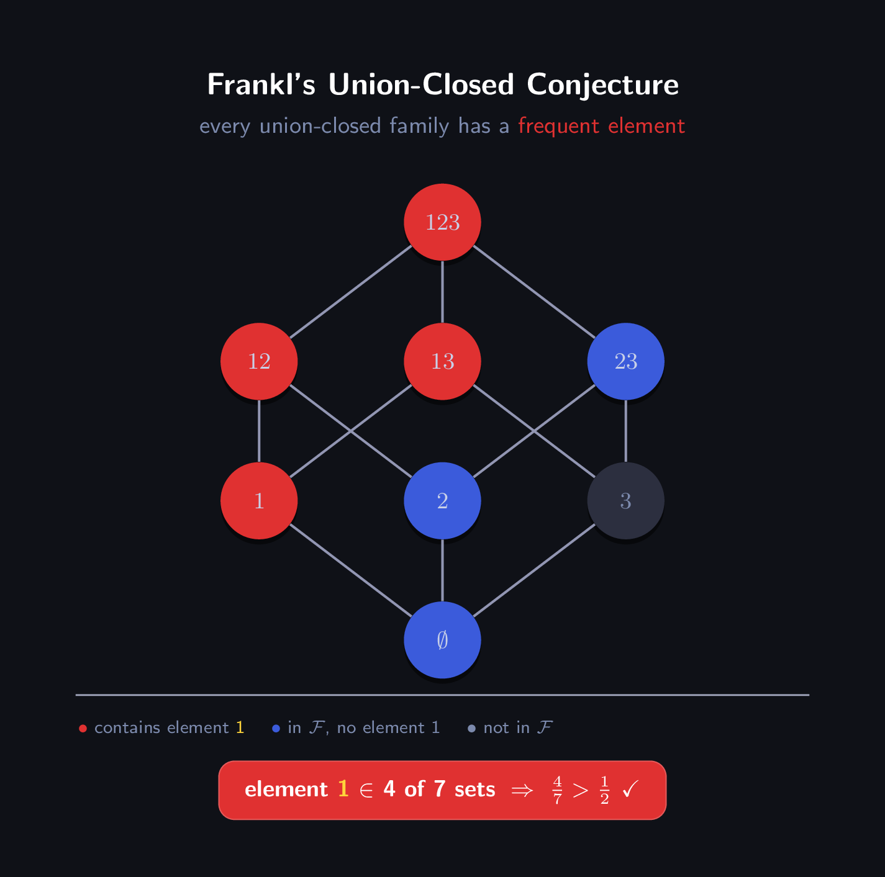

# Frankl's Union-Closed Sets Conjecture

**Math 475 Research Project · Fall 2026 · Vishesh Narayan**

<p align="center">
  
</p>

---

## The Problem

A family of sets $\mathcal{F}$ is **union-closed** if $A, B \in \mathcal{F} \Rightarrow A \cup B \in \mathcal{F}$.

**Frankl's Conjecture (~1979):** Every finite, nontrivial union-closed family has an element that belongs to at least half of its sets.

Despite its elementary statement, this has been open for over 40 years. No proof or counterexample is known in general.

---

## Repo Structure

```
.
├── report.tex          # LaTeX source for the individual report (due Nov 12)
├── enumerate.py        # Brute-force enumerator — verifies conjecture for n ≤ 4
├── timing.py           # Timed enumeration + extrapolation showing n ≥ 5 is infeasible
├── explore.ipynb       # Jupyter notebook with visualizations and analysis
├── rl_env.py           # Gymnasium RL environment for injection-based proof search
├── llm_agent.py        # LLM policy (llama3.2:3b via Ollama) that drives the env
├── inspect_traces.py   # Trace mining tool — surfaces novel mapping patterns
├── collect_traces.py   # Sweep runner: collects traces across multiple n values
├── build_dataset.py    # Filters winning traces → (prompt, completion) SFT pairs
├── finetune.py         # LoRA fine-tune on the SFT dataset (HuggingFace + PEFT)
└── icon.tex            # TikZ source for the diagram below
```

---

## Running the Code

**Requirements:** Python 3, with a virtual environment set up:

```bash
python3 -m venv .venv
source .venv/bin/activate
pip install jupyter seaborn pandas matplotlib gymnasium numpy requests
```

**Enumerator (terminal output):**
```bash
python3 enumerate.py
```

**Notebook (interactive):**
```bash
jupyter notebook explore.ipynb
```

**RL agent (requires [Ollama](https://ollama.com) running locally):**
```bash
ollama pull llama3.2:3b
python3 llm_agent.py --episodes 20 --n 4
```

**Mine agent traces for novel rules:**
```bash
python3 inspect_traces.py
python3 inspect_traces.py --successes-only --novel-only
```

**Collect traces across all n values (full sweep):**
```bash
python3 collect_traces.py           # n=2..5, ~900 total episodes
python3 collect_traces.py --dry-run # preview plan only
```

**Build fine-tuning dataset from winning traces:**
```bash
python3 build_dataset.py            # → dataset/train.jsonl
```

**Fine-tune a small model on successful proofs:**
```bash
pip install transformers peft datasets accelerate
python3 finetune.py                                      # Qwen2.5-1.5B default
python3 finetune.py --model Qwen/Qwen2.5-0.5B-Instruct  # smaller option
```

**Compile the report:**
```bash
pdflatex report.tex
```

---

## Computational Results

### Enumeration (exact, `enumerate.py`)

| n | Families found | Conjecture holds | Tight cases (best = 1/2) |
|---|----------------|-----------------|--------------------------|
| 2 | 8              | 8 / 8 ✓         | 2                        |
| 3 | 90             | 90 / 90 ✓       | 5                        |
| 4 | 4,542          | 4,542 / 4,542 ✓ | 15                       |

Tight cases are always complementary-pair families `{∅, A, [n]\A, [n]}` or the full power set `P([n])` — matching the theoretical extremal construction from Nagel (2023).

### Scalability wall (`timing.py`)

The search space is $2^{2^n - 1}$ candidate families — **doubly exponential** in $n$:

| n | Candidates | Runtime (actual / estimated) | Feasible? |
|---|------------|------------------------------|-----------|
| 2 | 8 | 0.0 ms | ✓ |
| 3 | 128 | 0.4 ms | ✓ |
| 4 | 32,768 | 72 ms | ✓ |
| 5 | ~2.1 × 10⁹ | ~6.2 hours | borderline |
| 6 | ~9.2 × 10¹⁸ | ~5 million years | ✗ |
| 7 | ~1.7 × 10³⁸ | ~10²⁶ years | ✗ |

Going from $n=5$ to $n=6$ doesn't double the work — it **squares** it. Brute-force enumeration is fundamentally infeasible beyond $n=4$; smarter algorithms (incremental family construction, symmetry reduction) would be needed to push further.

---

## RL Proof Search Environment

Since brute force is infeasible beyond $n=4$, a second angle treats proof discovery as a **reinforcement learning problem**.

### Proof strategy

The key insight is an injection-based sufficient condition: for a fixed element $x$, partition $\mathcal{F}$ into

$$\mathcal{F}^- = \{A \in \mathcal{F} : x \notin A\}, \qquad \mathcal{F}^+ = \{A \in \mathcal{F} : x \in A\}$$

If we can build an **injective** map $\varphi : \mathcal{F}^- \to \mathcal{F}^+$ of the form $\varphi(A) = A \cup B$ for some $B \in \mathcal{F}^+$, then $|\mathcal{F}^+| \geq |\mathcal{F}^-|$, so $x$ appears in at least half the sets — the conjecture holds for this family.

The RL task is to find, for each randomly sampled union-closed family, an element $x$ and a **B-selection rule** that makes $\varphi$ injective.

### Environment (`rl_env.py`)

| Component | Detail |
|-----------|--------|
| **State** | Feature vector of length $4n+3$: element frequencies, Φ-scores, density, presence of ∅ and singletons |
| **Action** | Discrete$(n \times K)$ — choose element $x$ and one of $K=7$ mapping rules |
| **Reward** | $+1.0$ for a valid injective proof; partial credit proportional to coverage $|\mathcal{F}^-|$ mapped injectively; penalty $-0.3$/$-0.5$ for using already-known rules |
| **Episode** | Single-step: one (element, rule) attempt per family |

**Mapping rules** (B-selection strategies):

| Index | Name | Strategy |
|-------|------|----------|
| 0 | `union_min` | smallest set in $\mathcal{F}^+$ (known — penalised) |
| 1 | `union_max` | largest set in $\mathcal{F}^+$ |
| 2 | `union_closest` | set in $\mathcal{F}^+$ with most overlap with $A$ |
| 3 | `union_disjoint_pref` | prefer sets in $\mathcal{F}^+$ disjoint from $A$ |
| 4 | `union_superset_pref` | prefer supersets of $A$ in $\mathcal{F}^+$ |
| 5 | `union_random` | uniform random from $\mathcal{F}^+$ |
| 6 | `singleton_injection` | map $A$ to $A \cup \{x\}$ when that set exists (known — penalised) |

### Φ-score (bijection signal)

The **Φ-score** of element $x$ is the average fraction of sets in the "upper shadow" $\Phi(A)$ that contain $x$:

$$\Phi(x) = \frac{1}{|\mathcal{F}|} \sum_{A \in \mathcal{F}} \frac{|\{C \in \Phi(A) : x \in C\}|}{|\Phi(A)|}$$

Empirically, families where the max Φ-score is high are easier to prove — it correlates with the existence of an injective map. The random baseline confirms: mean max Φ-score is 0.790 on proved families vs 0.681 on failures.

### LLM policy (`llm_agent.py`)

A local **llama3.2:3b** model (via Ollama) or any HuggingFace model acts as the policy. Each episode it receives a natural-language description of the family, its Φ-scores, and element frequencies, and returns a JSON action `{"element": x, "rule": r, "reason": "..."}`.

#### Sweep results — 931 episodes across n=2..5

| n | Episodes | Proved | Rate |
|---|----------|--------|------|
| 2 | 77  | 74  | 96.1% |
| 3 | 140 | 104 | 74.3% |
| 4 | 377 | 323 | 85.7% |
| 5 | 154 | 133 | 86.4% |

**Overall: 634/748 LLM-guided episodes proved (84.8%), 492 novel proofs (not using known strategies)**

#### Rule breakdown (LLM choices, excluding parse-fail fallbacks)

| Rule | Chosen | Proved | Rate | Note |
|------|--------|--------|------|------|
| `singleton_injection` | 171 | 142 | 83.0% | known — penalised |
| `union_superset_pref` | 154 | 141 | **91.6%** | |
| `union_closest`       | 131 | 126 | **96.2%** | |
| `union_disjoint_pref` | 121 | 105 | 86.8% | |
| `union_random`        | 141 | 108 | 76.6% | |
| `union_max`           | 30  | 12  | 40.0% | weak strategy |

**Key findings:**
- `union_closest` achieves the highest success rate (96.2%) — favouring the $B \in \mathcal{F}^+$ with the smallest symmetric difference from $A$
- `union_superset_pref` is the second strongest (91.6%) and is the most structurally motivated: it maps $A$ to $A \cup B$ where $B \supseteq A$, guaranteeing the image is strictly larger
- `union_max` performs poorly (40%) — taking the largest set in $\mathcal{F}^+$ is too coarse, frequently causing collisions
- The model still chooses `singleton_injection` (a known strategy) in ~23% of episodes, suggesting it hasn't fully internalised the novelty penalty — this is a fine-tuning signal
- Φ-score correlates with proof success: mean max Φ-score is **0.931** on proved families vs **0.892** on failures, confirming it is a useful state feature

### Trace mining (`inspect_traces.py`)

Every episode writes a full JSONL record to `traces/` including:
- The complete mapping $\varphi$: each $(A, B, A \cup B)$ triple
- Which sets were in $\mathcal{F}^-$ and $\mathcal{F}^+$
- The LLM's reasoning

`inspect_traces.py` classifies B-selection patterns (B⊇A, B∩A=∅, B⊆A, B∩A≠∅) across novel successful proofs. Recurring patterns that aren't already named rules are candidates to be promoted into new entries in the `RULES` catalogue — closing the loop for iterative rule discovery.

### Training pipeline

The 492 novel successful proof traces feed into a supervised fine-tuning (SFT) pipeline:

```
collect_traces.py  →  build_dataset.py  →  finetune.py
   (JSONL traces)      (prompt/completion     (LoRA on
                         pairs filtered          Qwen2.5-1.5B)
                         to novel wins)
```

The fine-tuned model learns to predict which (element, rule) pair succeeds given the family's features and Φ-scores, without relying on the penalised known strategies. Both Ollama (local) and HuggingFace direct inference (GPU cluster) are supported via `--backend ollama|hf`.

---

## References

- H. Bruhn, O. Schaudt — *The Journey of the Union-Closed Sets Conjecture*, Graphs and Combinatorics 31 (2015)
- N. Nagel — *Notes on the Union Closed Sets Conjecture*, arXiv:2208.03803 (2023)
- W.T. Gowers — *Frankl's union-closed conjecture: a possible Polymath project?* (2016)
